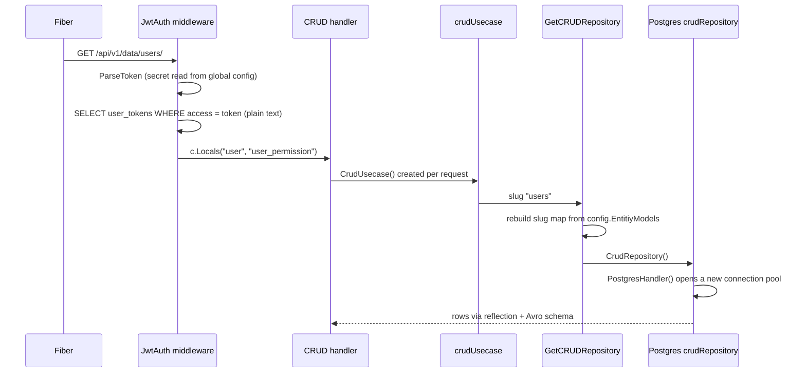
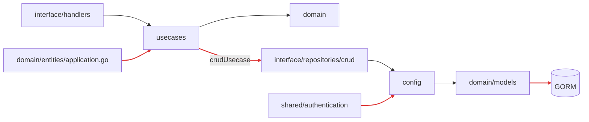
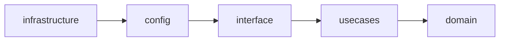
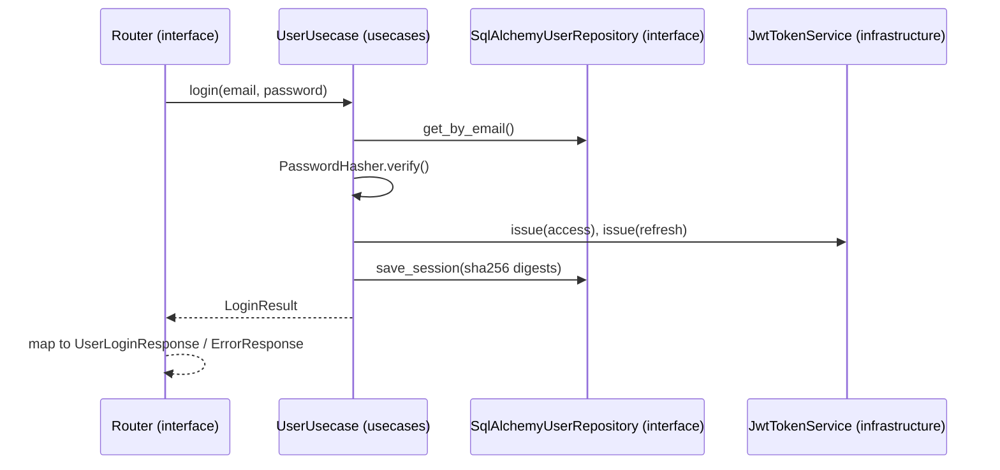

# Python Clean Architecture (FastAPI) + React

A Python rewrite of [max38/golang-clean-code-architecture](https://github.com/max38/golang-clean-code-architecture), plus a small React app that uses it.

| Folder | What |
|---|---|
| [`backend/`](backend) | FastAPI + SQLAlchemy 2 (async) + Alembic, PostgreSQL and MongoDB |
| [`frontend/`](frontend) | React + TypeScript: register / login / profile, and a data browser whose columns come from the API's `data_schema` |

Contents: [the original Go system](#the-original-go-system) ·
[the Python design](#the-python-design) · [what changed and why](#go-vs-python-what-changed-and-why) ·
[bugs fixed](#bugs-fixed-from-the-go-version) · [API](#api)

## Run it

```bash
# API (SQLite, no Docker needed)
cd backend
uv sync
export GOAPP_DATABASE_URL=sqlite+aiosqlite:///./dev.db
uv run alembic upgrade head
uv run serve                      # http://localhost:3000/swagger

# Frontend, in another terminal
cd frontend
pnpm install
pnpm dev                          # http://localhost:5173
```

With PostgreSQL + MongoDB: `cd backend && docker compose up --build` (runs migrations, then the API on :3000).

Give a user the `admin` permission (needed for `/data/user-permissions/`):

```bash
cd backend && uv run python -m app.infrastructure.cli grant-permission you@example.com admin
```

## The original Go system

The template is a starting point for REST APIs written with GoFiber, GORM and PostgreSQL (MongoDB optional),
organised after Uncle Bob's Clean Architecture. It has three features:

1. **Users and JWT auth**: register, login (access + refresh token), refresh, logout and a protected profile.
   Tokens are also saved in a `user_tokens` table, so logging out revokes them.
2. **Generic read-only data API**: every model listed in `config/crudModels.go` is served under
   `/api/v1/data/{slug}/`, with paging, get-by-id and a `/describe` endpoint that returns an Avro-style schema
   built by reflection. The same code serves Postgres tables and Mongo collections.
3. **Monitor**: `GET /api/v1/` returns the app name and version. Swagger UI at `/swagger`.

How a `/data` request runs in Go:



The folders follow Clean Architecture, but some imports go the wrong way (red), so the inner layers still depend
on GORM, the global config and concrete repositories:



## The Python design

Same four layers and the same API, but every import points inwards and the rule is checked by a test.

```text
backend/src/app
├── domain                      # business rules, no framework imports
│   ├── entities/               # dataclasses: User, TokenPair, DataListResponse, ...
│   ├── repositories/           # abstract interfaces (UserRepository, CrudRepository)
│   └── errors.py               # EmailAlreadyUsedError, InvalidTokenError, ...
├── usecases                    # application logic, depends only on domain
│   ├── user/user_usecase.py    # register, login, refresh, logout, authenticate
│   ├── user/ports.py           # PasswordHasher, TokenService (implemented in infrastructure)
│   ├── crud/crud_usecase.py    # generic read API + permission check
│   └── monitor.py
├── interface                   # adapters between the outside world and the use cases
│   ├── handlers/fastapi/       # routers, request/response schemas, JWT auth dependency
│   └── repositories/           # SQLAlchemy (postgres/) and Motor (mongodb/) implementations
├── config                      # settings (GOAPP_* env) and the list of models served by /data
├── infrastructure              # frameworks and drivers
│   ├── fastapi/container.py    # composition root: the only place that wires concrete classes
│   ├── fastapi/server.py       # app factory, middlewares, error handlers
│   ├── security/               # bcrypt, PyJWT
│   └── database/               # engine / Mongo client
└── shared                      # tiny helpers with no app imports
```

Imports only point inwards:



`infrastructure/fastapi/container.py` is the composition root: it creates the engine, the security services
and the use cases, and hands them to routers that are built by factory functions. Nothing below it reads
global state.

How a login request flows through the layers:



## Go vs Python: what changed and why

| | Go version | Python version | Why it matters |
|---|---|---|---|
| Wiring | `main.go` builds the user use case; the CRUD handler builds its use case and repository on every request | one composition root (`container.py`); routers get dependencies as arguments | one place to see and swap implementations |
| Config | global `config.Config` (koanf) read from JWT code and repositories | typed `Settings` (pydantic-settings, same `GOAPP_*` names), validated at start-up, passed in | no hidden globals; bad config fails fast |
| Domain entities | GORM structs with ORM tags live in `domain/models` | plain dataclasses; ORM models live in `interface/repositories` | the core logic doesn't depend on the database library |
| Use case dependencies | concrete JWT/bcrypt functions called directly | `PasswordHasher` and `TokenService` ports | use cases are tested with fakes and a fake clock |
| DB connections | new GORM pool each time a CRUD repository is created | one engine for the app, one session per request | no connection leak under load |
| Transactions | each GORM call auto-commits | one transaction per request, committed before the response is sent | no half-written requests; no 201 for a failed commit |
| Generic CRUD | reflection; every registered model is public | SQLAlchemy inspection + a registry with `exposed`, `hidden_fields` and `required_permission` | secrets can't leak through `/data`; permissions are enforced |
| Validation | `BodyParser` + hand-written email regex | pydantic request models (email, lengths) mapped to the same error body | less code, consistent 400s |
| API docs | Swagger comments written by hand (the README suggests generating them with ChatGPT); `/profile` is POST in code but GET in docs | OpenAPI generated from the route and model types | docs can't drift from the code |
| Migrations | GORM `AutoMigrate` | versioned Alembic migrations | reviewable, reversible schema changes |
| Tokens | stored in plain text; refresh lifetime = access lifetime | SHA-256 digests; correct lifetimes; token type checked; rotation keeps the first expiry | a DB leak isn't a session leak; sessions can't be extended forever |
| Tests | none | 56 tests (use cases, JWT, HTTP end to end) + import-linter contracts | refactors are safe; the architecture can't silently erode |
| Tooling | | ruff, mypy `--strict`, Docker, Makefile | |

Trade-off: the Go service is faster and ships as one binary. For an API whose time is spent in the database,
async FastAPI is fast enough, and the gain is in validation, generated docs and tests.

## Bugs fixed from the Go version

Behaviour is kept where it is intentional (one session per user, error codes, JWT claim layout, slugs, `GOAPP_*` names).
These were bugs or security problems in the original, fixed and covered by tests:

| Go version | Effect | Here |
|---|---|---|
| `user_tokens` is registered in `EntitiyModels` | any logged-in user can read every user's access and refresh tokens via `/data/user-tokens/` | not exposed; `hidden_fields` per model |
| tokens stored in plain text | a database leak = live sessions | stored as SHA-256 digests |
| refresh token uses `GOAPP_JWT_ACCESS_EXPIRES` | refresh token dies with the access token | uses `GOAPP_JWT_REFRESH_EXPIRES` |
| user permission is loaded but never checked | no way to protect a model | `required_permission` per model (403) |
| login returns GORM's `record not found` for an unknown email | reveals which emails have accounts | same message for both cases; a dummy bcrypt check keeps response time similar |
| duplicate email returns 500 | client can't tell what went wrong | 409 |
| list `total_data` = `RowsAffected` of the current page | wrong `total_page` | real `COUNT(*)` |
| list filters are parsed, then `nil` is passed | filters ignored | applied, only on visible fields, values cast to column type |
| `CrudRepository()` calls `PostgresHandler()` | a new connection pool on every `/data` request | one engine for the app |
| `strings.Replace` result is discarded in `getIssuerName` | issuer keeps spaces | fixed |
| logout parse error returns `users-003` | wrong trace id | `users-004` |
| route is `POST /profile`, swagger says `GET` | docs and code disagree | both methods |
| `domain/entities/application.go` imports `usecases`; `crudUsecase` imports a repository implementation | the dependency rule is broken | enforced by import-linter |
| CORS `*`, default secret `1234567890` | | configurable origins; app refuses to start in production with a short secret |

Not ported: the Go `Create` / `Update` / `Delete` CRUD methods, because they are stubs that return `nil` and have no routes.

## Where each Go file went

Go paths are relative to `src/` in the [original repo](https://github.com/max38/golang-clean-code-architecture); Python paths to `backend/src/app/`.

| Go | Python |
|---|---|
| `domain/entities/user/*.go` | `domain/entities/user.py` |
| `domain/models/user.go` (GORM structs) | `interface/repositories/postgres/models.py` |
| `domain/repositories/*.go` | `domain/repositories/*.py` |
| `usecases/user/userUsecase.go` | `usecases/user/user_usecase.py` |
| `usecases/crud/crudUsecase.go` | `usecases/crud/crud_usecase.py` |
| `interface/handlers/gofiber/modules/*` | `interface/handlers/fastapi/modules/*` |
| `interface/repositories/{postgres,mongodb}/*` | `interface/repositories/{postgres,mongodb}/*` |
| `interface/repositories/crud/crudRepository.go` | `interface/repositories/crud_registry.py` |
| `shared/authentication/JWTAuthentication.go` | `infrastructure/security/jwt_tokens.py` |
| `shared/crud/avroSchema.go` | `interface/repositories/schema.py` |
| `config/config.go`, `config/crudModels.go` | `config/settings.py`, `config/crud_models.py` |
| `infrastructure/gofiber/server/*` + `main.go` | `infrastructure/fastapi/{server,middlewares,container,main}.py` |
| `infrastructure/database/postgres/migration` (AutoMigrate) | `migrations/` (Alembic) |

## API

Same routes, bodies and error format (`{"trace_id": "users-001", "message": "..."}`) as the Go version.

| Method | Path | Auth | Notes |
|---|---|---|---|
| GET | `/api/v1/` | | name and version |
| POST | `/api/v1/users/register` | | 201, 409 if email is taken |
| POST | `/api/v1/users/login` | | returns user + access/refresh tokens |
| POST | `/api/v1/users/refresh-token` | | rotates both tokens |
| POST | `/api/v1/users/logout` | | revokes the session |
| GET, POST | `/api/v1/users/profile` | Bearer | |
| GET | `/api/v1/data/{slug}/describe` | Bearer | Avro-style schema of a model |
| GET | `/api/v1/data/{slug}/?_page=1&_pageSize=10&email=a@b.com` | Bearer | other query params filter by field |
| GET | `/api/v1/data/{slug}/{id}` | Bearer | |

Slugs: `users`, `user-permissions` (admin only), `products` (MongoDB example, enabled when `GOAPP_MONGODB_DB_ATLAS_URI` is set).

## Checks

```bash
(cd backend && make check)    # ruff + mypy --strict + import-linter + pytest (56 tests)
(cd frontend && pnpm test && pnpm lint && pnpm build)
```

- **56 tests**: use cases with in-memory fakes, the JWT service, and the HTTP API end to end (SQLite in memory + mongomock).
- **import-linter** enforces the dependency rule. If someone imports SQLAlchemy into a use case,
  or a use case imports a repository implementation, `pytest` fails (`backend/tests/architecture/test_layers.py`).

## Adding a model to `/data`

Inside `backend/`:

1. Define it in `src/app/interface/repositories/postgres/models.py` (set `hidden_fields` for anything secret).
2. Add one line to `src/app/config/crud_models.py`.
3. `uv run alembic revision --autogenerate -m "add xyz" && make migrate`
