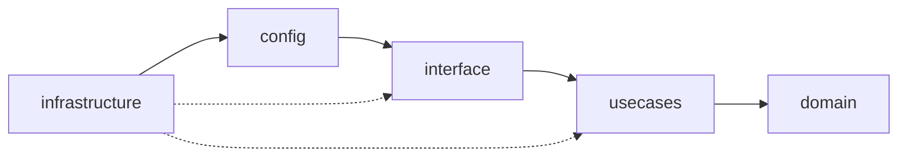
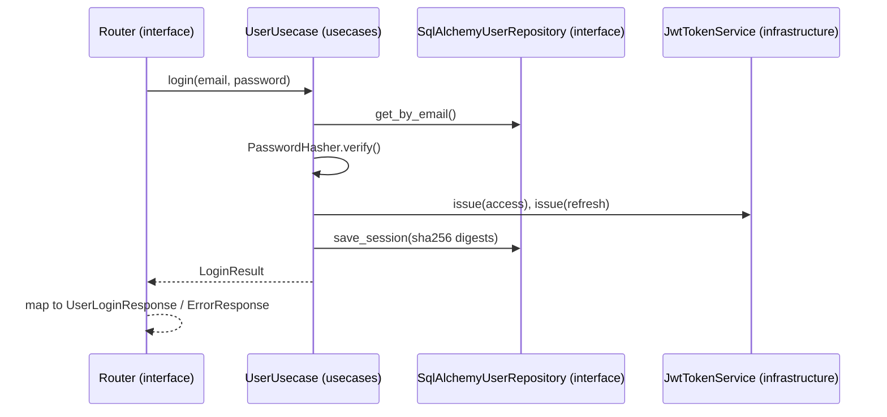

# Python Clean Architecture (FastAPI) + React

A Python rewrite of [max38/golang-clean-code-architecture](https://github.com/max38/golang-clean-code-architecture): same API, same `GOAPP_*` settings and the same
layers (domain → usecases → interface → infrastructure), built with FastAPI, SQLAlchemy 2 (async) and Alembic.
PostgreSQL and MongoDB are both supported, like the original. A small React app in `frontend/` uses the API.

| Folder | What |
|---|---|
| [`backend/`](backend) | FastAPI service |
| [`frontend/`](frontend) | React + TypeScript: register / login / profile, and a data browser whose columns come from the API's `data_schema` |

## Run it

```bash
# API (SQLite, no Docker needed)
cd backend
uv sync
export GOAPP_DATABASE_URL=sqlite+aiosqlite:///./dev.db
uv run alembic upgrade head
uv run serve                      # http://localhost:3000/swagger

# Frontend, in another terminal
cd frontend
pnpm install
pnpm dev                          # http://localhost:5173
```

With PostgreSQL + MongoDB: `cd backend && docker compose up --build` (runs migrations, then the API on :3000).

Give a user the `admin` permission (needed for `/data/user-permissions/`):

```bash
cd backend && uv run python -m app.infrastructure.cli grant-permission you@example.com admin
```

## Checks

```bash
(cd backend && make check)    # ruff + mypy --strict + import-linter + pytest (56 tests)
(cd frontend && pnpm test && pnpm lint && pnpm build)
```

- **56 tests**: use cases with in-memory fakes, the JWT service, and the HTTP API end to end (SQLite in memory + mongomock).
- **import-linter** enforces the dependency rule. If someone imports SQLAlchemy into a use case,
  or a use case imports a repository implementation, `pytest` fails (`backend/tests/architecture/test_layers.py`).

## API

Same routes, bodies and error format (`{"trace_id": "users-001", "message": "..."}`) as the Go version.

| Method | Path | Auth | Notes |
|---|---|---|---|
| GET | `/api/v1/` | | name and version |
| POST | `/api/v1/users/register` | | 201, 409 if email is taken |
| POST | `/api/v1/users/login` | | returns user + access/refresh tokens |
| POST | `/api/v1/users/refresh-token` | | rotates both tokens |
| POST | `/api/v1/users/logout` | | revokes the session |
| GET, POST | `/api/v1/users/profile` | Bearer | |
| GET | `/api/v1/data/{slug}/describe` | Bearer | Avro-style schema of a model |
| GET | `/api/v1/data/{slug}/?_page=1&_pageSize=10&email=a@b.com` | Bearer | other query params filter by field |
| GET | `/api/v1/data/{slug}/{id}` | Bearer | |

Slugs: `users`, `user-permissions` (admin only), `products` (MongoDB example, enabled when `GOAPP_MONGODB_DB_ATLAS_URI` is set).

## Structure

```text
backend/src/app
├── domain                      # business rules, no framework imports
│   ├── entities/               # dataclasses: User, TokenPair, DataListResponse, ...
│   ├── repositories/           # abstract interfaces (UserRepository, CrudRepository)
│   └── errors.py               # EmailAlreadyUsedError, InvalidTokenError, ...
├── usecases                    # application logic, depends only on domain
│   ├── user/user_usecase.py    # register, login, refresh, logout, authenticate
│   ├── user/ports.py           # PasswordHasher, TokenService (implemented in infrastructure)
│   ├── crud/crud_usecase.py    # generic read API + permission check
│   └── monitor.py
├── interface                   # adapters between the outside world and the use cases
│   ├── handlers/fastapi/       # routers, request/response schemas, JWT auth dependency
│   └── repositories/           # SQLAlchemy (postgres/) and Motor (mongodb/) implementations
├── config                      # settings (GOAPP_* env) and the list of models served by /data
├── infrastructure              # frameworks and drivers
│   ├── fastapi/container.py    # composition root: the only place that wires concrete classes
│   ├── fastapi/server.py       # app factory, middlewares, error handlers
│   ├── security/               # bcrypt, PyJWT
│   └── database/               # engine / Mongo client
└── shared                      # tiny helpers with no app imports
```

Imports only point inwards:



How a login request flows through the layers:



### Where each Go file went

Go paths are relative to `src/` in the [original repo](https://github.com/max38/golang-clean-code-architecture); Python paths to `backend/src/app/`.

| Go | Python |
|---|---|
| `domain/entities/user/*.go` | `domain/entities/user.py` |
| `domain/models/user.go` (GORM structs) | `interface/repositories/postgres/models.py` |
| `domain/repositories/*.go` | `domain/repositories/*.py` |
| `usecases/user/userUsecase.go` | `usecases/user/user_usecase.py` |
| `usecases/crud/crudUsecase.go` | `usecases/crud/crud_usecase.py` |
| `interface/handlers/gofiber/modules/*` | `interface/handlers/fastapi/modules/*` |
| `interface/repositories/{postgres,mongodb}/*` | `interface/repositories/{postgres,mongodb}/*` |
| `interface/repositories/crud/crudRepository.go` | `interface/repositories/crud_registry.py` |
| `shared/authentication/JWTAuthentication.go` | `infrastructure/security/jwt_tokens.py` |
| `shared/crud/avroSchema.go` | `interface/repositories/schema.py` |
| `config/config.go`, `config/crudModels.go` | `config/settings.py`, `config/crud_models.py` |
| `infrastructure/gofiber/server/*` + `main.go` | `infrastructure/fastapi/{server,middlewares,container,main}.py` |
| `infrastructure/database/postgres/migration` (AutoMigrate) | `migrations/` (Alembic) |

### Design choices

- **ORM models are not domain entities.** The Go `domain/models` carry GORM tags, so the domain depends on the ORM.
  Here the domain uses plain dataclasses and the repositories map ORM rows to them.
- **Use cases get their dependencies through the constructor.** Password hashing and JWT are ports
  (`usecases/user/ports.py`), so the use case tests run with fakes and a controllable clock, without a database.
- **One composition root.** `infrastructure/fastapi/container.py` builds everything. There is no global config
  object read from deep inside packages (Go's `config.Config` is read by the JWT code and every repository).
- **One transaction per request, committed before the response is sent.** FastAPI's default runs dependency
  clean-up *after* the response, which would answer 201 even if the commit then failed; the session dependency
  uses `scope="function"` instead (`backend/tests/api/test_transactions.py`).
- **Routers are built by factories** that receive their dependencies, so the interface layer never imports infrastructure.

## Changes from the Go version

Behaviour is kept where it is intentional (one session per user, error codes, JWT claim layout, slugs, `GOAPP_*` names).
These were bugs or security problems in the original, fixed and covered by tests:

| Go version | Effect | Here |
|---|---|---|
| `user_tokens` is registered in `EntitiyModels` | any logged-in user can read every user's access and refresh tokens via `/data/user-tokens/` | not exposed; `hidden_fields` per model |
| tokens stored in plain text | a database leak = live sessions | stored as SHA-256 digests |
| refresh token uses `GOAPP_JWT_ACCESS_EXPIRES` | refresh token dies with the access token | uses `GOAPP_JWT_REFRESH_EXPIRES` |
| user permission is loaded but never checked | no way to protect a model | `required_permission` per model (403) |
| login returns GORM's `record not found` for an unknown email | reveals which emails have accounts | same message for both cases; a dummy bcrypt check keeps response time similar |
| duplicate email returns 500 | client can't tell what went wrong | 409 |
| list `total_data` = `RowsAffected` of the current page | wrong `total_page` | real `COUNT(*)` |
| list filters are parsed, then `nil` is passed | filters ignored | applied, only on visible fields, values cast to column type |
| `CrudRepository()` calls `PostgresHandler()` | a new connection pool on every `/data` request | one engine for the app |
| `strings.Replace` result is discarded in `getIssuerName` | issuer keeps spaces | fixed |
| logout parse error returns `users-003` | wrong trace id | `users-004` |
| route is `POST /profile`, swagger says `GET` | docs and code disagree | both methods |
| `domain/entities/application.go` imports `usecases`; `crudUsecase` imports a repository implementation | the dependency rule is broken | enforced by import-linter |
| CORS `*`, default secret `1234567890` | | configurable origins; app refuses to start in production with a short secret |

Not ported: the Go `Create` / `Update` / `Delete` CRUD methods, because they are stubs that return `nil` and have no routes.

## Adding a model to `/data`

Inside `backend/`:

1. Define it in `src/app/interface/repositories/postgres/models.py` (set `hidden_fields` for anything secret).
2. Add one line to `src/app/config/crud_models.py`.
3. `uv run alembic revision --autogenerate -m "add xyz" && make migrate`
